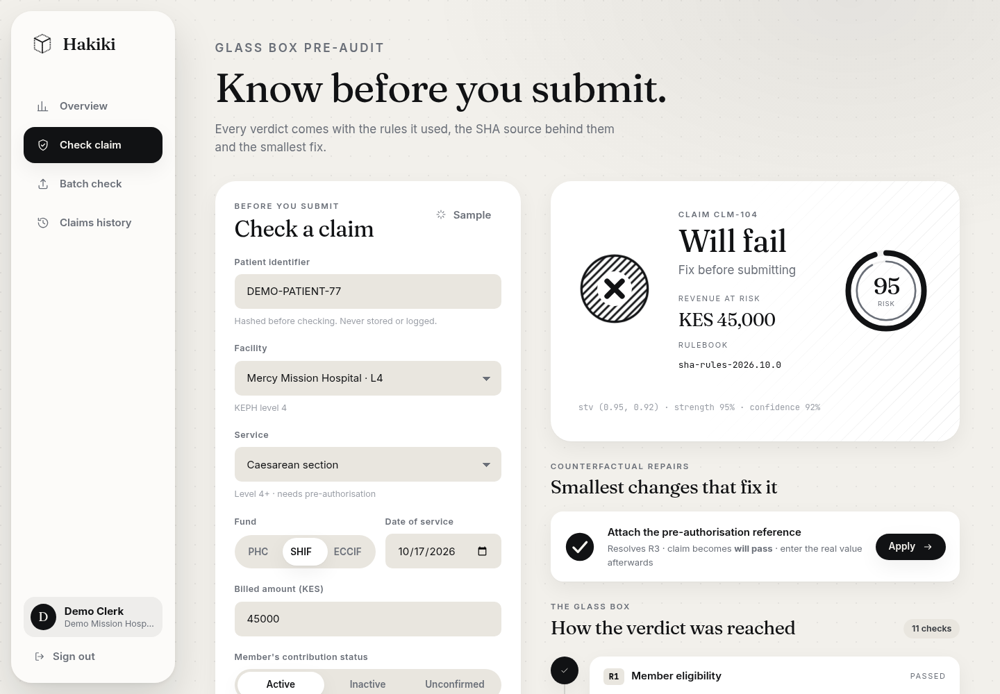
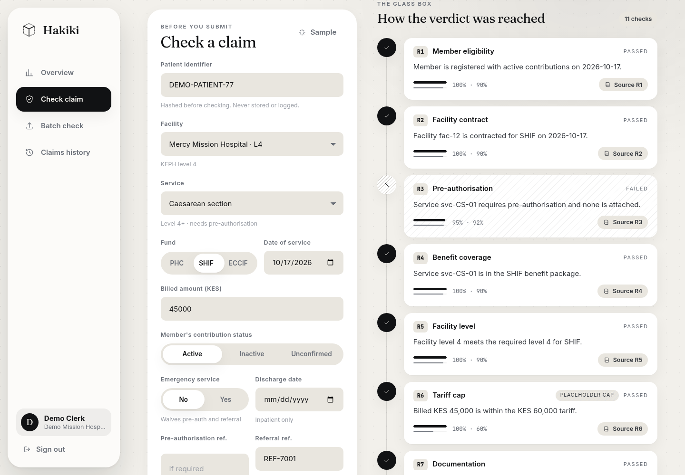
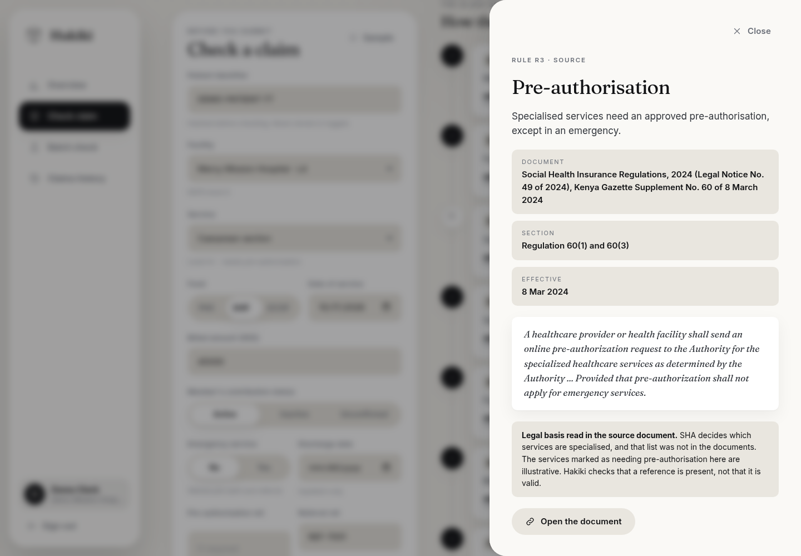
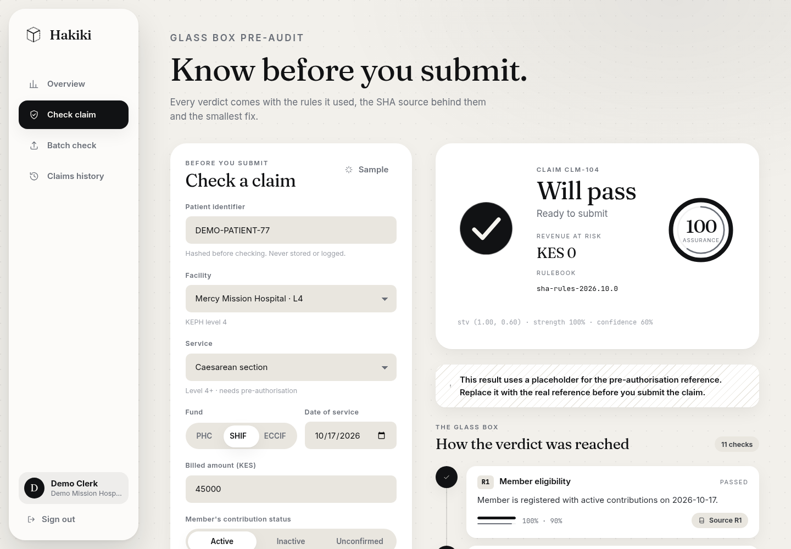
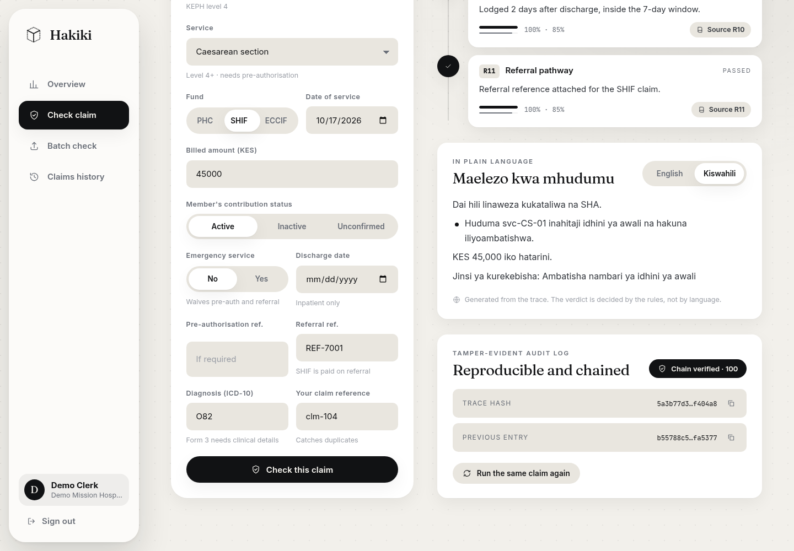
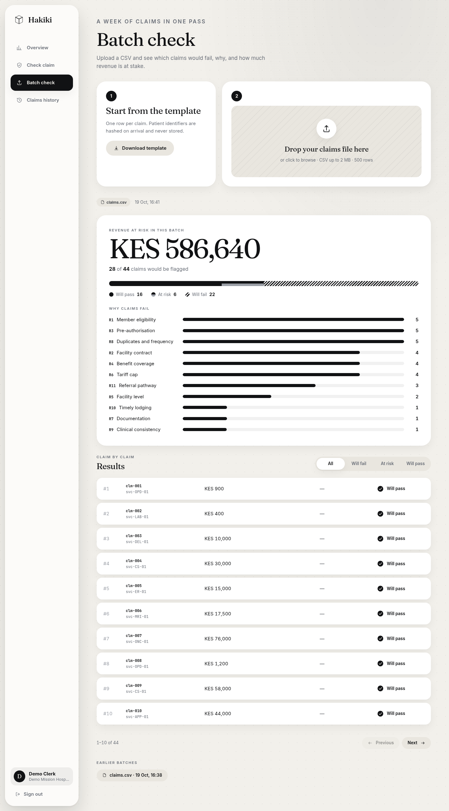
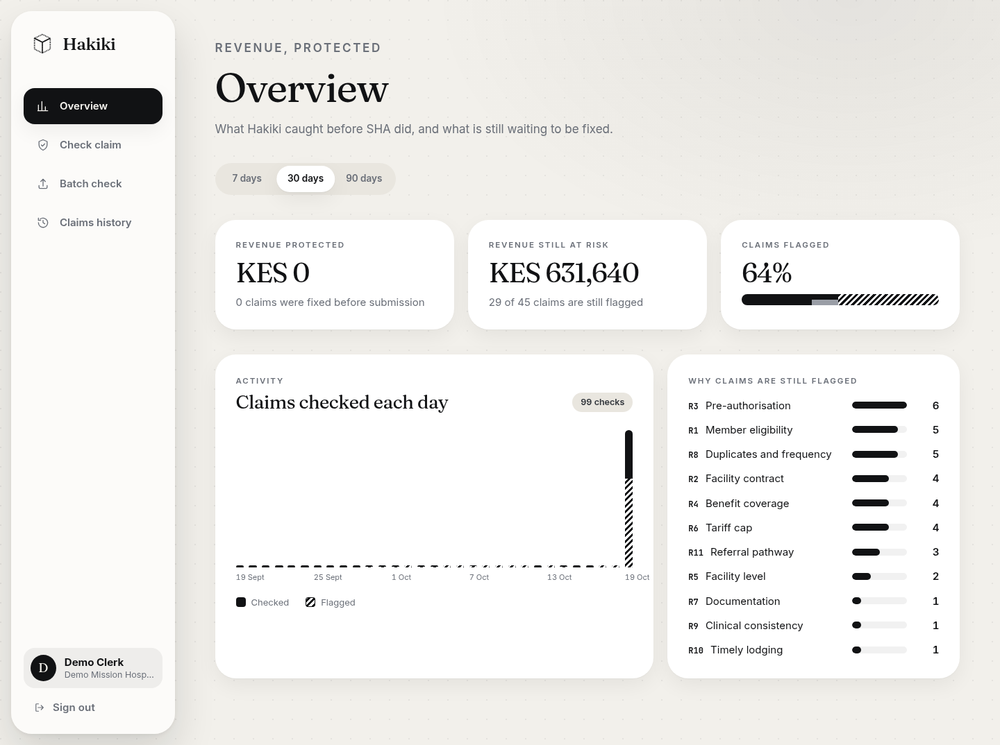
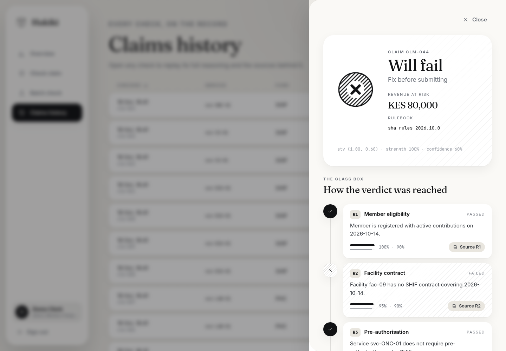
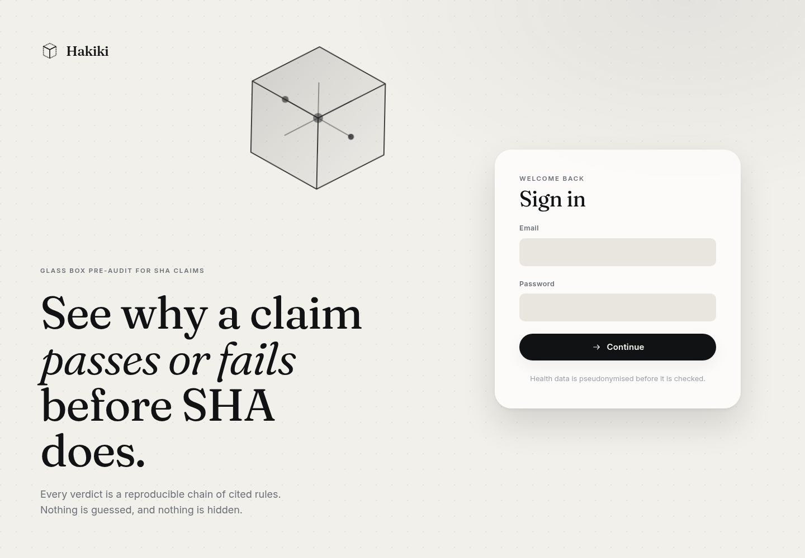
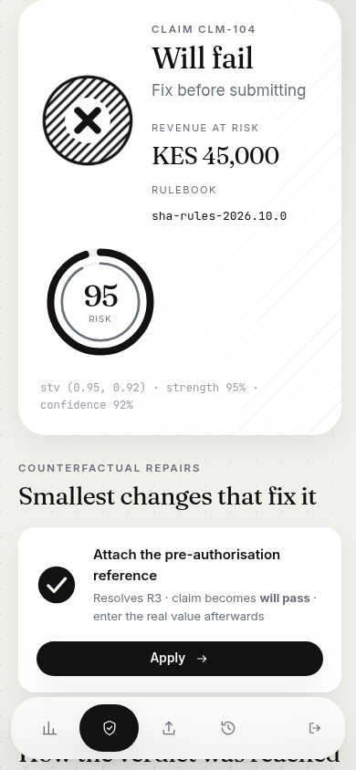

# Hakiki 🩺 — Glass Box SHA Claims Pre-Auditor

> **Hakiki** (Swahili: *verify, validate*) checks every Social Health Authority (SHA) claim **before** a facility submits it, and explains, step by step, exactly which rule it would fail and how to fix it. The reasoning runs on **MeTTa / OpenCog Hyperon**, so every decision is a transparent, reproducible logic trace instead of a black box.

---

## Screenshots

Captured from the seeded demo, so every claim you see is synthetic. Patient identifiers are hashed on arrival and never shown.

### Know before you submit

A claim is checked against the SHA rulebook. The verdict, its truth value and the revenue at risk come first, followed by the smallest change that fixes it.



### The glass box

Every verdict shows the eleven checks behind it. The failing rule is hatched, each step carries its truth value, and a placeholder tariff is labelled as one.



Each check links to the SHA regulation it relies on, with the quoted clause and whether it was read in the source document.



### Fix it, and prove it

Applying the fix re-runs the claim, and the verdict flips to pass. The pre-authorisation field is filled with a placeholder, and the page says so until the clerk enters the real reference.



### Explained in English or Kiswahili

The explanation is generated from the trace. A language model may phrase it, but a guard discards any text that disagrees with the verdict.



### A week of claims in one pass

Upload a CSV and see how many claims would fail, why, and how much revenue is at stake.



### Revenue protected

Finance managers see what Hakiki caught before SHA did: claims fixed before submission, what is still at risk, and why.



### Replay any check

Every check is kept in a hash-chained log. Open one from the history to see exactly how it was decided.



### Sign in, and on a phone

| Sign in | On a phone |
|---|---|
|  |  |

---

## 1. The Problem

Since Kenya moved from NHIF to the **Social Health Authority** (Social Health Insurance Act, 2023), care is financed through three funds:

- **Primary Healthcare Fund (PHC)**
- **Social Health Insurance Fund (SHIF)**
- **Emergency, Chronic and Critical Illness Fund (ECCIF)**

Each fund has its own benefit packages, tariffs, facility-level rules and pre-authorisation requirements.

For hospitals and clinics, this means:

- **Rejected and delayed claims** hit cash flow directly, and small private and faith-based facilities feel it most.
- **Opaque reasons:** billing staff often can't tell *which* rule a claim broke until it bounces.
- **Changing rules:** packages and tariffs get revised, and staff training lags behind.
- **Manual pre-checks:** billing clerks cross-check eligibility, pre-auth and tariffs by hand, under pressure.

Every rejected claim is **revenue the facility already earned but can't collect**.

## 2. The Solution

Hakiki sits **between the facility and SHA**. Before a claim goes out, the facility runs it through Hakiki and gets four things:

1. **A verdict:** `PASS`, `AT_RISK` or `WILL_FAIL`, with a truth value `(stv strength confidence)`.
2. **The Glass Box trace:** every fact, rule and inference step, linked to the exact clause of the SHA document it comes from.
3. **A fix list:** counterfactual repairs such as *"Add pre-authorisation number → claim passes rule R3."*
4. **A revenue-at-risk figure:** the amount that would be lost if the claim were submitted as it is.

### Design principle: the LLM never decides

| Layer | Responsibility | Deterministic? |
|---|---|---|
| Ingest (Python) | Claim form / CSV / HMIS export → structured facts | ✅ |
| **MeTTa reasoner** | **All verdicts**, through SHA rules + probabilistic risk | ✅ (same input + same rulebook version → same trace) |
| Trace recorder | Fired rules → proof tree, with a citation per rule | ✅ |
| Fix finder | Searches the minimal fact changes that flip `WILL_FAIL` → `PASS` | ✅ |
| LLM (optional) | Explains the trace in plain English or Swahili for billing staff | ❌, but it cannot change the verdict |

## 3. Who It's For

| User | Pain | Hakiki gives them |
|---|---|---|
| **Billing clerks** at clinics and hospitals | Claims bounce, no clear reason | A pre-check, the reason and the fix, before submission |
| **Facility owners / finance managers** | Cash-flow gaps | A revenue-at-risk dashboard, rejection trends, staff error patterns |
| **HMIS / EMR vendors** | Clients demand claim support | Hakiki API embedded in their system |
| **Billing agencies** | Manual work across many facilities | Multi-facility batch audits |

## 4. Rejection Rules (v1 rulebook)

Each rule cites the SHA document and regulation it relies on, with a short quote, in `kb/citations.json`. The documents are saved in `docs/sources/`, and the rulebook is **versioned**.

| ID | Rule family | Check | Legal basis | Read in source |
|---|---|---|---|---|
| `R1` | Member eligibility | Is the patient a registered member with active contributions on the date of service? | Regulations 6(2), 7(1), 57(2) | ✅ |
| `R2` | Facility contract | Is the facility empanelled and contracted for this fund on this date? | Regulation 57(1) | ✅ |
| `R3` | Pre-authorisation | Does this specialised service need pre-auth, and is a reference attached? Emergencies are exempt. | Regulation 60 | ✅ |
| `R4` | Benefit coverage | Is the service in the package of the fund being claimed? | Regulation 7(3), Second Schedule | ✅ |
| `R5` | Facility level | Is the facility's KEPH level high enough under this fund? | Regulation 10(c)(ii), Second Schedule | ✅ |
| `R6` | Tariff | Does the billed amount exceed the tariff? | Annexure B1-A | ✅ for 2 tariffs, placeholders elsewhere |
| `R7` | Documentation | Is the clinical detail (diagnosis code) that Form 3 requires present? | Regulation 58(4) | ✅ |
| `R8` | Duplicates & frequency | Same patient, service and date as an earlier claim? Frequency limit exceeded? | Regulation 61(3) | ❌ practice, not defined in the text |
| `R9` | Clinical consistency | Does the diagnosis match the service? | Regulation 59(3)(b) | ❌ standard ICD-10 groupings |
| `R10` | Timely lodging | Is the claim lodged within seven days of discharge? | Regulation 58(1) | ✅ |
| `R11` | Referral pathway | Is a referral attached for Social Health Insurance Fund services? Emergencies are exempt. | Regulations 6(3), 7(2), 10(b) | ✅ |

> The rulebook uses real SHA instruments, but the facility registry, the service catalogue and every tariff cap except the two Primary Healthcare Fund maternity rates are illustrative, and the trace marks placeholder caps. `docs/sources/SOURCES.md` lists what was read and what is still missing. Confirm the rulebook against the latest SHA circulars before relying on it in production.

## 5. How the Glass Box Works

### 5.1 Facts from a claim (synthetic)

```metta
; Facts produced by ingest/ (synthetic example)
(Claim clm-104 pat-77 fac-12 svc-CS-01 (date 2026 10 14) 45000)
(Member pat-77 Registered)
(ContributionStatus pat-77 (date 2026 10 14) Active)
(Facility fac-12 (level 4) (contracted SHIF))
(Service svc-CS-01 (fund SHIF) (requiresPreauth True) (minLevel 4))
(Preauth clm-104 None)
```

### 5.2 A rule with a citation and truth value

```metta
; R3 — Missing pre-authorisation (illustrative; see kb/rules/r3_preauth.metta)
(= (check-r3 $clm)
   (match &self
     (, (Claim $clm $pat $fac $svc $date $amt)
        (Service $svc (fund $fund) (requiresPreauth True) $lvl)
        (Preauth $clm None))
     (Fail $clm R3-MissingPreauth (stv 0.95 0.92)
           (because (service-requires-preauth $svc) no-preauth-attached)
           (cite "SHA benefit package / pre-auth guideline, section ref in kb/citations.json")
           (fix (attach-preauth $clm)))))
```

### 5.3 The trace the billing clerk sees

```json
{
  "claim": "clm-104",
  "verdict": "WILL_FAIL",
  "truth_value": { "strength": 0.95, "confidence": 0.92 },
  "revenue_at_risk_kes": 45000,
  "trace": [
    { "step": 1, "rule": "R1-Eligibility", "result": "pass", "fact": "Member registered, contributions active on 14 Oct 2026" },
    { "step": 2, "rule": "R2-FacilityContract", "result": "pass", "fact": "Facility fac-12 contracted for SHIF" },
    { "step": 3, "rule": "R5-FacilityLevel", "result": "pass", "fact": "Level 4 ≥ required level 4" },
    { "step": 4, "rule": "R3-MissingPreauth", "result": "fail", "stv": [0.95, 0.92],
      "fact": "Service svc-CS-01 requires pre-authorisation; none attached",
      "citation": "kb/citations.json#R3" }
  ],
  "fixes": [
    { "action": "Attach pre-authorisation reference", "flips_to": "PASS" }
  ],
  "rulebook_version": "sha-rules-2026.10.0",
  "trace_hash": "sha256:…",
  "prev_hash": "sha256:…"
}
```

**Reproducible:** the same claim checked against the same `rulebook_version` always gives the same trace and hash. Traces go into a **hash-chained audit log**, which the facility can use when it appeals a rejection.

> **Honesty note:** Hakiki predicts claim outcomes from published rules and observed patterns. It does not replace SHA adjudication. Truth values express calibrated confidence, not guarantees.

## 5.4 Why MeTTa

Claims adjudication is a rules problem with uncertainty and an audit requirement. A clerk and an auditor both need to know *which rule* decided *what*, and a score from a black-box model cannot say that. MeTTa gives Hakiki three things together:

1. **Rules as data.** Each SHA rule is a few lines in `kb/rules/`, next to the regulation it comes from. When a circular changes a rule, the diff is the rule, and the golden tests show exactly which traces moved.
2. **Uncertainty that composes.** Every result carries a truth value `(stv strength confidence)`, and `kb/combine.metta` folds them into a verdict with a documented formula. Placeholder tariffs lower confidence automatically, so the verdict is honest about what it knows.
3. **Traceable inference.** The same claim and rulebook version always produce the same trace and the same hash, which is what lets a facility use the log when it appeals a rejection.

The language model is optional and sits outside this loop. It may explain a trace in English or Swahili, and a guard discards any explanation that disagrees with the verdict or names a rule that did not fire.

## 6. Architecture

```
 ┌──────────────────┐  ┌───────────────┐  ┌────────────────────┐
 │ Refine dashboard │  │ CSV / Excel   │  │ HMIS / EMR vendor  │
 │ (billing clerk)  │  │ batch upload  │  │ API integration    │
 └────────┬─────────┘  └──────┬────────┘  └─────────┬──────────┘
          └──────────────┬────┴─────────────────────┘
                         ▼
               ┌───────────────────┐
               │  FastAPI gateway  │  tenant auth, RBAC, rate limits
               └─────────┬─────────┘
                         ▼
               ┌───────────────────┐
               │ Ingest + validate │  claim → facts; PHI pseudonymised
               └─────────┬─────────┘
                         ▼
               ┌───────────────────┐      ┌───────────────────────┐
               │  MeTTa reasoner   │◄────►│ Versioned SHA rulebook │
               │  (hyperon)        │      │ kb/rules/*.metta       │
               └─────────┬─────────┘      │ kb/citations.json      │
                         ▼                └───────────────────────┘
               ┌───────────────────┐
               │ Trace + fix finder│──► Hash-chained audit log (Postgres)
               └─────────┬─────────┘
                         ▼
               ┌───────────────────┐
               │ Narrator (LLM,    │  EN/SW explanation; trace-locked
               │ optional)         │
               └─────────┬─────────┘
                         ▼
               ┌───────────────────┐
               │ Reports           │  revenue at risk · rejection trends
               └───────────────────┘
```

## 7. Tech Stack

| Concern | Choice |
|---|---|
| Reasoning | **MeTTa** through the `hyperon` Python package |
| API | Python 3.11+, FastAPI, Pydantic |
| Dashboard | Refine + React + TypeScript |
| Storage | PostgreSQL (claims facts, audit log), Redis (rate limits, queues) |
| Batch | CSV/Excel upload → background workers |
| Narration | Any LLM API behind an adapter, switchable off |
| Billing (later) | M-Pesa Daraja STK Push for subscriptions |
| Deploy | Docker Compose → VPS / cloud (Kenyan hosting for production, see §10) |

## 8. Repository Structure

```
hakiki-claims/
├── kb/
│   ├── rules/               # r1_eligibility.metta … r9_clinical.metta
│   ├── reference/           # tariffs, packages, facility levels (data atoms)
│   ├── citations.json       # rule → SHA document + section
│   ├── combine.metta        # combines rule outcomes into a verdict
│   └── VERSION              # rulebook version, e.g. sha-rules-2026.10.0
├── reasoner/
│   ├── engine.py            # loads rulebook, runs checks via hyperon
│   ├── trace.py             # fired rules → trace tree
│   ├── fixes.py             # counterfactual fix search
│   └── audit.py             # hash-chained log
├── ingest/
│   ├── claim_schema.py      # Pydantic model of a claim
│   ├── csv_import.py        # batch upload
│   └── pseudonymise.py      # HMAC tokens for patient identifiers
├── api/
│   ├── main.py
│   ├── security.py          # auth, RBAC, tenant isolation
│   └── routes/
├── narrator/                # LLM adapter, EN/SW, trace-locked
├── dashboard/               # Refine app
├── data/synthetic/          # synthetic claims ONLY — no real patient data
├── tests/
│   ├── golden/              # same claim → same trace hash
│   └── rules/               # one test per rule, pass and fail
├── docker-compose.yml
├── ROADMAP.md
└── README.md
```

## 9. Quick Start

```bash
git clone https://github.com/ByteGigs-Labs/hakiki-claims.git
cd hakiki-claims
cp .env.example .env              # set secrets; never commit .env

# Everything in containers (API on :8000, dashboard on :8080)
docker compose up --build
docker compose exec api python -m scripts.seed      # demo user + four weeks of synthetic claims
```

### Local backend development

`hyperon` ships wheels for Python 3.12 and earlier, so the project is pinned to **Python 3.12** (`.python-version`).

```bash
python3.12 -m venv .venv && source .venv/bin/activate
pip install -r requirements-dev.txt
docker compose -f docker-compose.yml -f docker-compose.dev.yml up -d postgres redis
alembic upgrade head
uvicorn api.main:app --reload
pytest                              # needs the dev Postgres + Redis above

cd dashboard && npm install && npm run dev   # http://localhost:5173
```

Check a synthetic claim from the command line:

```bash
python -m reasoner.engine --claim data/synthetic/missing_preauth.json
```

Install the git hooks (ruff, gitleaks) once with `pip install pre-commit && pre-commit install`. CI runs the same checks on every push, plus the full test suite against Postgres and Redis.

Regenerate the synthetic dataset and its expected outcomes with `python -m scripts.build_synthetic`.

### API

All endpoints except `/health` need the session cookie from `POST /v1/auth/login`. Programs can use an API key instead on the check, explanation and batch endpoints (see below). Errors share one shape: `{"error": {"code", "message", "fields?"}}`.

| Endpoint | Purpose |
|---|---|
| `POST /v1/auth/login` · `POST /v1/auth/logout` · `GET /v1/auth/me` | Session cookie (httpOnly, SameSite=Strict) |
| `POST /v1/claims/check` | Check one claim → verdict, trace, fixes, hashes |
| `GET /v1/claims/{trace_hash}/explanation?lang=en\|sw` | Plain-language explanation of a stored check |
| `GET /v1/claims?_start&_end&_sort&_order` | Claims history, `X-Total-Count` header |
| `POST /v1/claims/batch` | Upload a CSV (multipart `file`) → 202, processed in the background |
| `GET /v1/claims/batch/template` | CSV template |
| `GET /v1/claims/batch` · `GET /v1/claims/batch/{id}` · `GET /v1/claims/batch/{id}/rows?verdict=` | Batch status, summary and results |
| `GET /v1/citations/{rule}` | SHA document and section behind a rule |
| `GET /v1/reports/overview?days=` | Revenue protected and at risk, daily activity and top failure causes (finance managers and admins) |
| `GET /v1/audit/verify` | Verifies the tenant's hash chain |

| `POST /v1/api-keys` · `GET /v1/api-keys` · `DELETE /v1/api-keys/{id}` | Admins create, list and revoke API keys (session only) |

### API keys

An admin creates a key with `POST /v1/api-keys {"name": "Billing system"}`. The full key (`hk_<prefix>_<secret>`) appears once in that response, and only its SHA-256 hash is stored. A key acts as a clerk of the admin's facility, can be revoked at any time, and has its own rate limit.

```bash
curl -X POST http://localhost:8000/v1/claims/check \
  -H "Authorization: Bearer hk_..." -H "Content-Type: application/json" \
  -d '{"claim_ref": "clm-1", "patient_id": "A1234567", "facility_id": "fac-12", "service_code": "svc-CS-01", "fund": "SHIF", "date_of_service": "2026-10-14", "amount_kes": 45000}'
```

A key works on `POST /v1/claims/check`, `GET /v1/claims/{trace_hash}/explanation`, `POST /v1/claims/batch` and the batch status and rows endpoints. Every other endpoint, including history and key management, needs a browser session.

### API contract

`docs/openapi.json` is the frozen contract, and `dashboard/src/types.ts` mirrors it. A test fails when either drifts from the other. To change the contract, run `python -m scripts.export_openapi`, update `types.ts`, and get the pull request approved by both owners.

### How a verdict is produced

1. `ingest/claim_schema.py` validates the claim and swaps any raw `patient_id` for an HMAC token.
2. `reasoner/facts.py` turns the claim and the reference data in `kb/reference/` into MeTTa atoms.
3. Each rule in `kb/rules/` returns one `Result` with a truth value, and `kb/combine.metta` folds them into `PASS`, `AT_RISK` or `WILL_FAIL`. A risk with strength 0.8 or more means `WILL_FAIL`. Several risks combine as a noisy-or, and the confidence is the weakest one.
4. `reasoner/fixes.py` proposes edits and re-runs the claim to prove each one.
5. The result goes into the hash-chained audit log. `trace_hash` covers the result, and `prev_hash` links to the tenant's previous entry.

Revenue at risk is the billed amount for `WILL_FAIL`, the billed amount times the risk strength for `AT_RISK`, and zero for `PASS`.

> The demo rulebook uses real SHA instrument names, but tariff caps and section references are placeholders flagged `verified: false` in `kb/citations.json`. Confirm them against the current SHA schedule before relying on any verdict.

## 10. Security & Privacy (health data is sensitive personal data)

- **Synthetic data only** in the repo and the demo.
- **Pseudonymisation:** patient IDs and names become keyed HMAC tokens before reasoning. The reasoner never sees names.
- **Data minimisation:** only the fields the rules need are stored, and full clinical notes are never kept.
- **Tenant isolation:** each facility's data is scoped by tenant ID at the query layer, and covered by tests.
- **RBAC:** clerk, finance manager and admin roles, with every access logged.
- **Tamper-evident audit log:** hash-chained traces, verified in CI.
- **Encryption:** TLS in transit, encrypted storage at rest, secrets in a vault.
- **Prompt-injection safe:** free-text fields are data. The LLM sees only the structured trace.
- **Production hosting:** check the data-localisation and processing requirements under the **Data Protection Act 2019**, its regulations and the **Digital Health Act 2023** before going live, and register with the ODPC as a data processor where required.

## 11. Compliance Mapping

| Requirement | How Hakiki supports it |
|---|---|
| DPA 2019: sensitive personal data (health) | Pseudonymisation, minimisation, access logging, retention limits |
| DPA 2019, s.35: automated decisions | Hakiki advises and a human submits. Every verdict has a readable trace |
| Digital Health Act 2023 | Hosting and data-handling review before production |
| SHA rules | Versioned, cited rulebook so every check traces back to a published source |

*Not legal advice. A Kenyan health-data and data-protection practitioner should review the design before production.*

## 12. Business Model

| Tier | Customer | Pricing |
|---|---|---|
| **Starter** | Dispensaries, clinics (Level 2–3) | Monthly subscription via M-Pesa, capped claims per month |
| **Hospital** | Level 4–5 private, mission and county facilities | Per-facility subscription + per-claim checks above the cap |
| **Recovery** | Facilities with a backlog of rejected claims | Percentage of successfully resubmitted claim value |
| **Partner API** | HMIS / EMR vendors, billing agencies | Per-check API pricing, revenue share |

**Why they'll pay:** Hakiki costs less than the claims it saves. The dashboard shows **"KES recovered or protected this month"** so the return is visible.

## 13. Limitations

- SHA rules change. The rulebook must be updated on every circular, and claims are checked against a versioned rulebook.
- Hakiki can't see SHA's internal adjudication, so eligibility data comes from what the facility already verifies.
- v1 truth values are expert-set and need calibration against real accept/reject outcomes from design partners.
- MeTTa/Hyperon is still evolving, so versions are pinned and golden-trace tests guard behaviour.

## 14. Team

| Role | Name | Owns |
|---|---|---|
| Reasoning lead | — | `kb/`, `reasoner/` |
| Backend & security | — | `api/`, `ingest/`, audit log |
| Product & frontend | — | `dashboard/`, customer interviews, demo, pitch |

## 15. License

MIT for code. The rulebook files in `kb/` are CC BY 4.0, with attribution to the source SHA documents.
